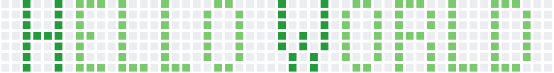
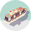
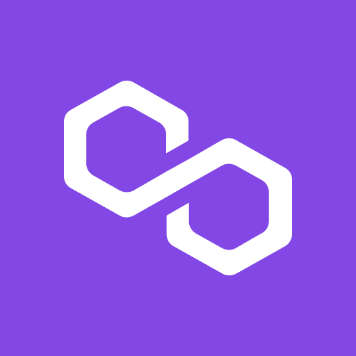
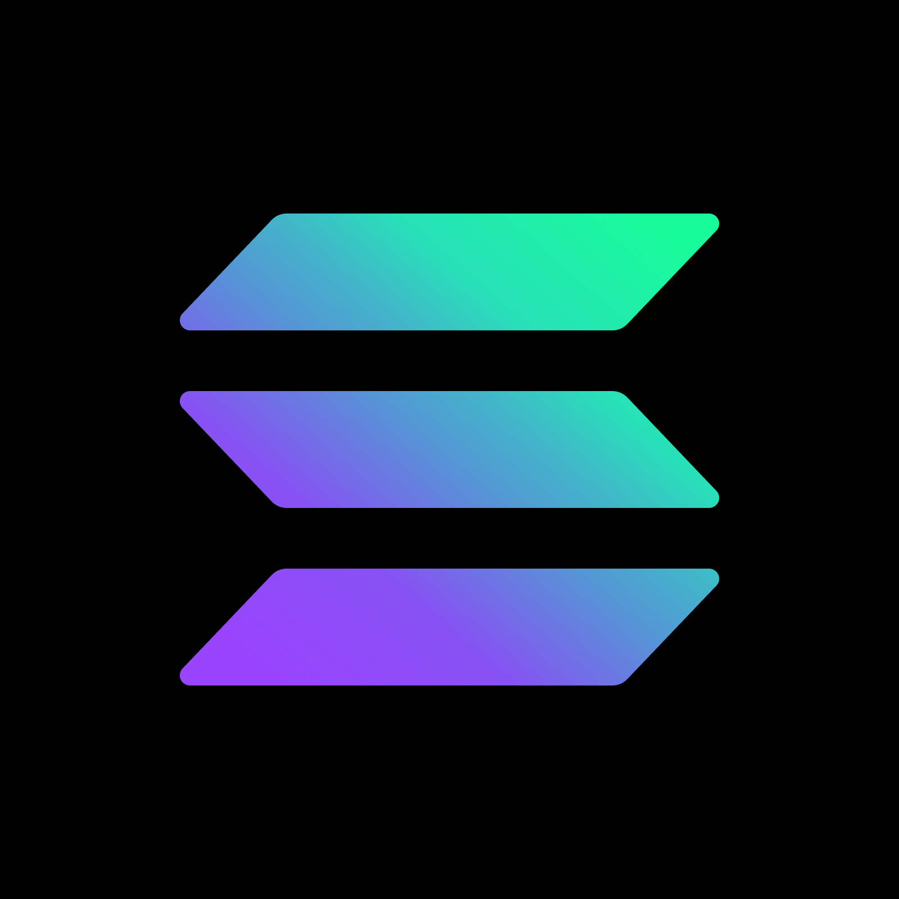

<div align="center">
 <a href="https://dio.me/sign-up?ref=64FGMY2B6E">
  
 </a>
</div>

<!--🔄 Próxima atualização prevista: **13/11/2026 às 22:53**  
⏱️ Intervalo: 15 minutos · Horário de Brasília.-->

## 🏠 Status do meu Homelab 
<!-- HOMELAB-UPDATE:START -->
🕒 Última atualização das badges: **13/11/2026 às 23:29**  
🔄 Próxima atualização prevista: **13/11/2026 às 23:38**  
⏱️ Intervalo: 15 minutos · Horário de Brasília.
<!-- HOMELAB-UPDATE:END -->
[](https://github.com/marcosbarker/marcosbarker/actions/workflows/atualizar-badges-servidor.yml)

### Servidores


### Rede e DNS


### Aplicações e serviços


<!--
<div align="center">
 
</div>
&nbsp;&nbsp;&nbsp;&nbsp;&nbsp;&nbsp;&nbsp;&nbsp;&nbsp;&nbsp;&nbsp;&nbsp;&nbsp;&nbsp;&nbsp;&nbsp;&nbsp;&nbsp;&nbsp;&nbsp;&nbsp;&nbsp;&nbsp;&nbsp;&nbsp;&nbsp;&nbsp;&nbsp;&nbsp;&nbsp;&nbsp;&nbsp;&nbsp;&nbsp;&nbsp;[](https://open.spotify.com/user/marcos_barker)
-->
<!--
<div align="center">
  <p>
    <a href="https://coinmarketcap.com/">
      <h1>My cRyPtOs</h1>
    </a>
  </p>
    <a href="https://cardano.org/">
      
    </a>
    <a href="https://www.algorand.com/">
      
    </a>
    <a href="https://www.binance.com/pt-BR">
      
    </a>
    <a href="https://chronosecosystem.com/">
      
    </a>
    <a href="https://crypto.com/">
       
    </a>
 <!--
    <a href="https://www.cryptoships.club/">
      
    </a>
-->
<!--
    <a href="https://coinshopp.io/pt/coinshopp-cshop/">
      
    </a>
    <a href="https://dogelonmars.com/">
      
    </a>
    <a href="https://fantom.foundation/">
      
    </a>
    <a href="https://chain.link/">
      
    </a>
    <a href="https://polygon.technology/">
      
    </a>
    <a href="https://shibatoken.com/">
      
    </a>
    <a href="https://solana.com/">
      
    </a>
    <a href="https://tether.to/en/">
      
    </a>
</div>
-->
<br>
<div align="center">
  <a href="https://open.spotify.com/user/marcos_barker">
  
</div>
 
<!--[](https://open.spotify.com/user/marcos_barker)<br>-->
<!--&nbsp;&nbsp;&nbsp;&nbsp;&nbsp;&nbsp;&nbsp;&nbsp;&nbsp;&nbsp;&nbsp;&nbsp;&nbsp;&nbsp;&nbsp;&nbsp;&nbsp;&nbsp;&nbsp;-->

 <br>

<!--&nbsp;&nbsp;&nbsp;&nbsp;&nbsp;&nbsp;&nbsp;&nbsp;&nbsp;&nbsp;&nbsp;&nbsp;&nbsp;&nbsp;&nbsp;&nbsp;&nbsp;&nbsp;&nbsp;&nbsp;&nbsp;&nbsp;&nbsp;&nbsp;&nbsp;&nbsp;&nbsp;&nbsp;&nbsp;&nbsp;&nbsp;&nbsp;&nbsp;&nbsp;&nbsp;&nbsp;&nbsp;&nbsp;&nbsp;&nbsp;&nbsp;&nbsp;&nbsp;&nbsp;&nbsp;&nbsp;&nbsp;&nbsp;&nbsp;&nbsp;&nbsp;&nbsp;&nbsp;&nbsp;&nbsp;&nbsp;&nbsp;&nbsp;&nbsp;&nbsp;&nbsp;&nbsp;&nbsp;&nbsp;&nbsp;&nbsp;&nbsp;&nbsp;&nbsp;&nbsp;&nbsp;&nbsp;&nbsp;&nbsp;&nbsp;&nbsp;&nbsp;&nbsp;-->
&nbsp;&nbsp;&nbsp;&nbsp;&nbsp;&nbsp;&nbsp;&nbsp;&nbsp;&nbsp;&nbsp;&nbsp;&nbsp;&nbsp;&nbsp;&nbsp;&nbsp;&nbsp;[](https://github.com/ellerbrock/open-source-badges/)     <!--&nbsp;&nbsp;&nbsp;&nbsp;&nbsp;&nbsp;&nbsp;&nbsp;&nbsp;&nbsp;&nbsp;&nbsp;&nbsp;&nbsp;&nbsp;&nbsp;&nbsp;&nbsp;&nbsp;&nbsp;&nbsp;&nbsp;&nbsp;&nbsp;&nbsp;&nbsp;&nbsp;&nbsp;--> [](https://github.com/marcosbarker/marcosbarker/actions/workflows/waka-readme.yml) <!--[](https://wakatime.com/@bf89f39c-412c-49f3-aff6-6f6512e18f18)--> <!-- -->  

<!--
<div align="center">
  <a href="https://linktr.ee/marcos_barker">
  
  </a></br>
</div>
-->
<!--servidores-stats-->
<!--https://readme-stats-marcosbarker.vercel.app/-->
<!--https://github-readme-stats.vercel.app/-->
<!--
<div align="center">
  
</div>
-->
<div align="center">
  
</div>

<br>

<!--


-->

<!--START_SECTION:waka-->


**I'm an Early 🐤** 

```text
🌞 Morning                429 commits         ████░░░░░░░░░░░░░░░░░░░░░   16.24 % 
🌆 Daytime                1166 commits        ███████████░░░░░░░░░░░░░░   44.15 % 
🌃 Evening                648 commits         ██████░░░░░░░░░░░░░░░░░░░   24.54 % 
🌙 Night                  398 commits         ████░░░░░░░░░░░░░░░░░░░░░   15.07 % 
```
📅 **I'm Most Productive on Friday** 

```text
Monday                   408 commits         ████░░░░░░░░░░░░░░░░░░░░░   15.45 % 
Tuesday                  456 commits         ████░░░░░░░░░░░░░░░░░░░░░   17.27 % 
Wednesday                352 commits         ███░░░░░░░░░░░░░░░░░░░░░░   13.33 % 
Thursday                 317 commits         ███░░░░░░░░░░░░░░░░░░░░░░   12.00 % 
Friday                   472 commits         ████░░░░░░░░░░░░░░░░░░░░░   17.87 % 
Saturday                 267 commits         ███░░░░░░░░░░░░░░░░░░░░░░   10.11 % 
Sunday                   369 commits         ███░░░░░░░░░░░░░░░░░░░░░░   13.97 % 
```


📊 **This Week I Spent My Time On** 

```text
🕑︎ Time Zone: America/Sao_Paulo

🔥 Editors: 
VS Code                  7 hrs 7 mins        ██████████████░░░░░░░░░░░   55.10 % 
Visual Studio            4 hrs 1 min         ████████░░░░░░░░░░░░░░░░░   31.13 % 
Codex Vscode             53 mins             ██░░░░░░░░░░░░░░░░░░░░░░░   06.90 % 
Visual                   52 mins             ██░░░░░░░░░░░░░░░░░░░░░░░   06.76 % 
Unknown Editor           0 secs              ░░░░░░░░░░░░░░░░░░░░░░░░░   00.11 % 

💻 Operating System: 
Windows                  12 hrs 56 mins      █████████████████████████   100.00 % 
```

🤖 **AI Coding This Week** 

```text
⏱ AI Coding Time: 8 hrs 7 mins (62.78%)

✍️ 6 lines written by AI, 4,106 lines written by hand (0.15% AI-written)

🔤 16,701,508 Input Tokens, 64,664 Output Tokens

💵 $98.41 Estimated AI Cost This Week

🧠 7 AI Sessions, 107 AI Prompts

Qwen                     6 lines             █████████████████████████   100.00 % 
Cline-Cli                0 lines             ░░░░░░░░░░░░░░░░░░░░░░░░░   00.00 % 
Vscode                   0 lines             ░░░░░░░░░░░░░░░░░░░░░░░░░   00.00 % 
Visualstudio             0 lines             ░░░░░░░░░░░░░░░░░░░░░░░░░   00.00 % 
GPT                      0 lines             ░░░░░░░░░░░░░░░░░░░░░░░░░   00.00 % 

🔎 AI Coding Insights:
🧑‍💻 Mostly Hands-On — 0.15% of written lines came from AI
📚 Verbose Prompter — average 2,604 characters per prompt
🔁 Iterative Prompter — average 15 prompts per session
🔍 Hands-On Reviewer — 99.86% of changed lines were hand-edited
```


 Last Updated on 13/11/2026 04:59:20 UTC
<!--END_SECTION:waka-->

<!--INICIO GRAFICO-->

<!--
<a>
  
</a>
-->

<!--FIM GRAFICO-->

<!--INICIO PINS STIYLE-->
<!--
<a href="https://github.com/marcosbarker/alura.imersaoJava.2023">
  
</a>
<a href="https://github.com/marcosbarker/alura.imersaoDev.2023">
  
</a>
<a href="https://github.com/OsZeressemos/zeroCommerce">
  
</a>  
<a href="https://github.com/marcosbarker/serratec.residencia">  
  
</a>
<a href="https://github.com/marcosbarker/alura.imersaoDev">
  
</a>  
<a href="https://github.com/marcosbarker/alura.imersaoReact-Alurakut">  
  
</a>
<a href="https://github.com/marcosbarker/SUS-agendamento">
  
</a>
<a href="https://github.com/marcosbarker/DecolaTech-Avanade">  
  
</a>
<a href="https://github.com/marcosbarker/instagram-clone-homepage">  
  
</a>
<a href="https://github.com/marcosbarker/netflix-simple-copy">  
  
</a>
<a href="https://github.com/marcosbarker/javaPOO">
  
</a>
<a href="https://github.com/marcosbarker/NLW4-rocketpay">  
  
</a>
<a href="https://github.com/marcosbarker/Csharp-CFBcursos">
  
</a>  
<a href="https://github.com/marcosbarker/zeromonMarketPlace">  
  
</a>

<!--FIM PINS STIYLE-->
<!--
#c64dff
#3AFC55
#52fa5a
#ffc64d
#3B93E6
#4dfcff
#ffffff
#9e4c98
#00e658
#df82f2
#000000
-->
<!--INICIO AREA TESTE
* # EM TESTE 🧪🧪🧪🧪
Spotify Recently Played README Generator<br>
Markdown code snippet:

For custom count (1 ≤ {count} ≤ 10):

For custom width (300 ≤ {width} ≤ 1000):

FIM AREA TESTE-->
